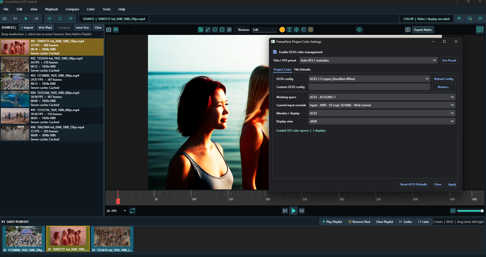

# FrameDeck 中文增强版



FrameDeck 是一款便携的 VFX 审片播放器（Windows / Ubuntu），基于
[subing85/viewline](https://github.com/subing85/viewline) 扩展。本版本在原版基础上完成了
**全界面中文汉化、国际化（i18n）架构与 Shotgun RV 式逐帧拖动**三项增强。

> 二次开发详情、架构约束与事故教训见 [DEVELOPMENT_ARCHIVE.md](DEVELOPMENT_ARCHIVE.md)；
> 构建方法见 [BUILD.md](BUILD.md)。

## 快速开始

- **免安装运行**：双击 `dist/FrameDeck.exe`（109 MB 单文件版，无需 Python）。
- 用户数据存于 `%USERPROFILE%\Documents\framedeck`；网络媒体缓存存于 `%LOCALAPPDATA%\FrameDeck\FrameDeck\media-cache`。
- 单文件版不含 ACES 1.2 色彩配置（程序以 OCIO Off 模式容错运行）；需要完整色彩管理请用 `./build.sh windows` 构建多目录版。

## 本版本新增

1. **界面中文化**：全部菜单 / 面板 / 对话框 / 状态栏 / PDF 报告中文（约 470 条，术语对标 DaVinci Resolve 等专业软件中文版）。
2. **国际化架构**：以英文原句为键的 `tr()` 体系，语言文件在 `resources/i18n/`，内置 **9 种语言**：
   简体中文 / 繁體中文 / English / 日本語 / 한국어 / Русский / Français / Deutsch / Español。
   菜单 **工具 → 语言** 即时切换（同进程重建窗口，当前素材自动保留），选择持久化到 QSettings。
3. **逐帧拖动（RV 式 scrub）**：导航模式下在画面上**按住左键左右拖动**即可逐帧微调进度
   （每 10 像素 = 1 帧，`constants.FRAME_DRAG_PIXELS_PER_FRAME` 可调）；拖动自动暂停播放，
   松手停在当前位置不自动恢复；与标注、平移、缩放、伽马/曝光检查互不干扰。

## 功能概览（继承自原版）

- 一次导入多个 MP4/MOV/AVI/EXR/PNG/JPG 素材；镜头播放列表时间线按连续全局帧域播放。
- A/B 对比：划像 / 叠加 / 差值 / 并排 / 棋盘格 / 闪烁等多种模式，VFX 命名自动匹配 B 侧。
- EXR AOV 审查、图像序列播放、逐帧铅笔/文本/箭头标注、逐帧评论（图钉、已解决/未解决）。
- OCIO 色彩管理（ACES 1.2 离线包 + ACES 1.3/2.0 内置配置、常用摄影机 Log 预设）。
- 伽马 / 曝光检查、通道隔离（RGB/R/G/B/Alpha/Luma）、影院遮幅。
- 服务器缓存与 2K 代理、PyAV/FFmpeg 广谱解码（H.264/H.265/AV1/ProRes…）、SMPTE 时间码（含丢帧制）。
- 导出：全分辨率静帧 / 图像序列 / 高质量 MP4 / 审片 PDF 报告 / 笔记 CSV。

## 快捷键与鼠标

| 输入 | 动作 |
| --- | --- |
| 空格 | 播放 / 暂停 |
| 左 / 右 | 上一帧 / 下一帧 |
| **画面上按住左键左右拖** | **逐帧微调进度（10px = 1 帧）** |
| 滚轮 | 指针处缩放 |
| 中键拖动 | 平移 |
| 右键拖动 | 连续缩放 |
| Y + 左键上下拖 | 伽马检查（Y 或 Esc 复位） |
| E + 左键上下拖 | 曝光检查（E 或 Esc 复位） |
| 双击画面 / F11 | 沉浸式全屏 |
| F | 适配画面 |
| Esc | 退出全屏或标注模式 |
| Alt+左 / Alt+右 | 调整所选镜头顺序 |
| Ctrl+Shift+S / Ctrl+Shift+O | 保存 / 打开 `.fdplaylist` |
| Ctrl+Enter | 提交当前审片评论 |

完整列表见 帮助 → FrameDeck 快捷键（程序内）。

## 从源码构建

```bash
./build.sh              # 自动：Windows 构建单 exe，Linux 构建 AppImage
./build.sh onefile      # 单文件 exe → dist/FrameDeck.exe
./build.sh windows      # Windows 多目录 → dist/FrameDeck/（含 ACES 1.2）
./build.sh linux        # Ubuntu 22.04+ AppImage（需先安装 python3-venv libgl1 libegl1 等）
```

Windows 上用 Git Bash 运行；详见 [BUILD.md](BUILD.md)。

## 文档索引

| 文档 | 内容 |
| --- | --- |
| [DEVELOPMENT_ARCHIVE.md](DEVELOPMENT_ARCHIVE.md) | 开发存档总纲：改造历史、架构约束、事故教训、遗留事项 |
| [BUILD.md](BUILD.md) | 构建方法（脚本 / 手动 / 开发运行） |
| `doc/l10n/` | 术语表、汉化规范、译文索引、静态验收工具 |

## 出处与许可

保留原 Viewline 的 Git 历史与 Apache-2.0 许可，见 [LICENSE](LICENSE)。
内置 ACES 1.2 归档的来源与校验值见 `resources/ocio/ACES_1.2_SOURCE.txt`。
